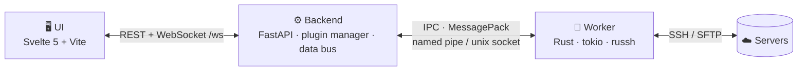

<div align="center">

# Synex

**One window for your servers.**<br>
SSH terminal, live monitoring, Docker, SFTP and git deploys in a single desktop app.

**English** | [Русский](README.ru.md)

[](https://github.com/ZeroDDP/Synex/actions/workflows/backend.yml)
[](https://github.com/ZeroDDP/Synex/actions/workflows/rust.yml)


<!-- TODO(release): бейдж последнего релиза, когда появится первый тег

-->

<!-- TODO(screenshots): главный скриншот или GIF (10–15 с: подключение → живые графики), до 5 МБ

-->

[Features](#features) · [Architecture](#architecture) · [Quick start](#quick-start) · [Configuration](#configuration) · [Development](#development) · [Roadmap](#roadmap) · [Team](#team)

</div>

---

## Why

Managing a handful of servers usually means a terminal, an SFTP client, a Docker UI, a
monitoring dashboard and a pile of shell scripts. Synex puts them into one minimal
workspace, and every part of it is a plugin you can switch on or off while the app runs.

## Features

| | Module | What it does | Backend | UI |
|---|---|---|:---:|:---:|
| 🔐 | **SSH** | Several sessions at once with a terminal each, encrypted key vault, saved connections. Server keys are verified on first use (TOFU); keys already in `~/.ssh/known_hosts` are trusted automatically | ✅ | 🚧 |
| 📈 | **Monitoring** | CPU, RAM, disks, network and GPU of every connected server, streamed to the UI twice a second, with avg / min / max over a window | ✅ | ✅ |
| 🐳 | **Docker** | Containers on the server: list, start, stop, restart, remove, read logs and follow them live | ✅ | 🚧 |
| 📁 | **Files** | Two-pane SFTP manager: browse, upload and download files and whole folders, SHA-256 verification, progress and cancel | ✅ | 🚧 |
| 🚀 | **Git** | Repositories on the server: status, history, fetch, fast-forward pull and deploy with your own command | ✅ | 🚧 |
| 🧩 | **Plugins** | Every module is a plugin: enable or disable it at runtime, the choice survives a restart | ✅ | — |

✅ done · 🚧 in progress

<!-- TODO(screenshots): когда экраны будут готовы, по два в ряд
<table>
  <tr>
    <td width="50%"><p align="center"><sub>Dashboard: live metrics</sub></p></td>
    <td width="50%"><p align="center"><sub>Terminal: several sessions</sub></p></td>
  </tr>
  <tr>
    <td width="50%"><p align="center"><sub>Files: two-pane SFTP</sub></p></td>
    <td width="50%"><p align="center"><sub>Docker: containers and logs</sub></p></td>
  </tr>
</table>
-->

## Architecture

A microkernel: the core provides only the platform, the UI shell and a data bus. Features
live in independent plugins, so the system grows without breaking its foundation.



| Layer | Folder | Stack | Role |
|---|---|---|---|
| UI | [`frontend/`](frontend) | Svelte 5, Vite | Screens, live charts, terminal |
| Backend | [`backend/`](backend) | Python 3.12, FastAPI, WebSockets, uv | API for the UI, plugins, data bus; starts and supervises the worker |
| Core | [`core/`](core) | Rust, tokio, russh, russh-sftp | SSH sessions, SFTP, server metrics |

**Plugins** (`backend/app/plugins/`):

| Plugin | Version | Needs | API |
|---|---|---|---|
| `ssh` | 0.5.0 | — | `/api/ssh` — sessions, commands, terminal WebSocket, trusted server keys |
| `keys` | 0.1.0 | — | `/api/keys` — encrypted SSH key vault |
| `connections` | 0.1.0 | `ssh` | `/api/connections` — saved servers |
| `monitor` | 0.2.0 | `ssh` | `/api/monitor` and the `metrics` stream in `/ws` |
| `docker` | 0.2.0 | `ssh` | `/api/docker` — containers, logs, live log WebSocket |
| `git` | 0.1.0 | `ssh` | `/api/git` — status, log, fetch, pull, deploy |
| `sftp` | 0.1.0 | `ssh` | `/api/sftp` — files and folders, transfers with progress in `/ws` |

Enable or disable any of them at runtime: `POST /api/plugins/{name}/enable` and `/disable`.

**Security by design:** the API listens on `127.0.0.1` only and refuses requests from
other web origins; SSH keys are stored encrypted (master key in the OS keychain);
server keys are verified before every connection; passwords never reach the logs.

More: [backend/README.md](backend/README.md) (API, plugins, errors, tests) ·
[core/README.md](core/README.md) (worker protocol).

## Quick start

You need **Python 3.12 + [uv](https://docs.astral.sh/uv/)** and **Node.js 22**. The worker is
prebuilt for Windows x64 and Linux x86_64; on macOS build it with `cargo` (see RUNNING.md).

```bash
git clone https://github.com/ZeroDDP/Synex.git
cd Synex
cd backend && uv sync && cp .env.example .env && cd ..   # PowerShell: Copy-Item .env.example .env
cd frontend && npm ci && cd ..
```

Run in two terminals:

```bash
cd backend && uv run python -m app.main      # API on http://127.0.0.1:8000
cd frontend && npm run dev                   # UI on http://localhost:5173
```

No server at hand? Set `WS_FAKE_METRICS=true` in `backend/.env` and the dashboard shows a demo server.
Health check: http://127.0.0.1:8000/api/health. Step-by-step guide and troubleshooting: **[RUNNING.md](RUNNING.md)**.

<!-- TODO(release): когда будет сборка приложения (SYN-73)
### Download

| OS | File |
|---|---|
| Windows 10/11 x64 | [Synex-setup.exe](https://github.com/ZeroDDP/Synex/releases/latest) |
| Linux x86_64 | [Synex.AppImage](https://github.com/ZeroDDP/Synex/releases/latest) |
-->

## Configuration

All settings live in `backend/.env`; every one of them is described in
[`backend/.env.example`](backend/.env.example). The ones you are most likely to touch:

| Setting | Default | What it does |
|---|---|---|
| `PLUGINS_ENABLED` | `*` | Which plugins to load (`*` = all) |
| `WS_FAKE_METRICS` | `false` | Demo metrics without an SSH server |
| `OPENSSH_KNOWN_HOSTS` | `true` | Trust servers whose keys are already in `~/.ssh/known_hosts` |
| `PLUGINS_REMEMBER` | `true` | Keep plugins switched at runtime switched after a restart |
| `SFTP_FOLDER_LIMIT` | `100000` | Max files and folders in one folder transfer |
| `DEBUG` | `false` | Swagger UI at http://127.0.0.1:8000/api/docs |

## Development

```text
Synex/
├── backend/        FastAPI app, plugins, tests (unit + integration with a real SSH server)
├── core/           Rust workspace: synex_core (SSH, SFTP, metrics) and synex_worker (IPC server)
├── frontend/       Svelte UI
└── .github/        CI workflows
```

**Tests**

```bash
cd backend
uv run ruff check . && uv run ruff format --check .
uv run pytest                       # unit tests, run anywhere
uv run pytest -m integration        # full cycle: real worker + local sshd (Linux/macOS)
```

```bash
cd core
cargo test
```

**CI** on every pull request: lint, backend tests on Linux, Windows and macOS (plus an
emulated-shell run), integration tests with the bundled worker and with a worker built from
`core/`, Rust builds for Linux and Windows.

**Contributing:** one task, one branch (`backend/…`, `core/…`, `frontend/…`), pull requests
into `main` with green checks. Details: [CONTRIBUTING.md](CONTRIBUTING.md).

## Roadmap

- [x] SSH sessions, key vault, saved connections, server key verification
- [x] Live monitoring: CPU, RAM, disks, network, GPU
- [x] Docker: containers and live logs
- [x] SFTP: files and whole folders with verification
- [x] Git: pull and deploy
- [x] Plugin manager: switch modules at runtime
- [ ] UI: terminal, file manager, Docker and git screens
- [ ] Desktop build for Windows and Linux (Release Candidate)
- [ ] Cancel running commands and transfers in the worker
- [ ] macOS and Linux musl builds of the worker
- [ ] AI assistant integration (v2.0)

<!-- TODO(release): ссылка на CHANGELOG или страницу релизов после v1.0.0-rc1 -->

## Team

**ZeroDDP** — student software development team, Tomsk Polytechnic University (ESITR).

| | Role |
|---|---|
| [Danil Tyustin](https://github.com/Rinneway) | Backend & logic |
| [Ivan Blinnikov](https://github.com/MAGVANCHiK) | Core (Rust) |
| [Ilya Kolesnikov](https://github.com/Prefifix) | Frontend |
| [Polina Smirnykh](https://github.com/appolsmirnykh-ship-it) | Design |

## License

[MIT](LICENSE) © 2026 ZeroDDP

