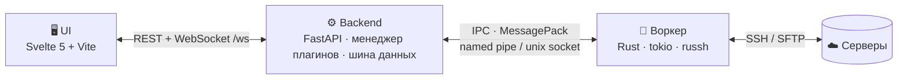

<div align="center">

# Synex

**Все ваши серверы в одном окне.**<br>
SSH-терминал, мониторинг в реальном времени, Docker, SFTP и git-деплой в одном desktop-приложении.

[English](README.md) | **Русский**

[](https://github.com/ZeroDDP/Synex/actions/workflows/backend.yml)
[](https://github.com/ZeroDDP/Synex/actions/workflows/rust.yml)


<!-- TODO(release): бейдж последнего релиза, когда появится первый тег

-->

<!-- TODO(screenshots): главный скриншот или GIF (10–15 с: подключение → живые графики), до 5 МБ

-->

[Возможности](#возможности) · [Архитектура](#архитектура) · [Быстрый старт](#быстрый-старт) · [Настройки](#настройки) · [Разработка](#разработка) · [План](#план) · [Команда](#команда)

</div>

---

## Зачем

Чтобы управлять несколькими серверами, обычно держат открытыми терминал, SFTP-клиент,
Docker UI, дашборд мониторинга и папку shell-скриптов. Synex собирает всё это в одно
минималистичное рабочее пространство, и каждая его часть — плагин, который включается и
выключается прямо на работающем приложении.

## Возможности

| | Модуль | Что делает | Backend | UI |
|---|---|---|:---:|:---:|
| 🔐 | **SSH** | Несколько сессий одновременно, у каждой свой терминал; зашифрованное хранилище ключей, сохранённые подключения. Ключ сервера проверяется при первом подключении (TOFU); ключи, которые уже есть в `~/.ssh/known_hosts`, принимаются сами | ✅ | 🚧 |
| 📈 | **Мониторинг** | CPU, RAM, диски, сеть и GPU каждого подключённого сервера, в UI дважды в секунду, со средним, минимумом и максимумом за окно | ✅ | ✅ |
| 🐳 | **Docker** | Контейнеры на сервере: список, запуск, остановка, перезапуск, удаление, логи и live-лог | ✅ | 🚧 |
| 📁 | **Файлы** | Двухпанельный SFTP-менеджер: просмотр, загрузка и скачивание файлов и целых папок, сверка SHA-256, прогресс и отмена | ✅ | 🚧 |
| 🚀 | **Git** | Репозитории на сервере: статус, история, fetch, pull только перемоткой вперёд и деплой своей командой | ✅ | 🚧 |
| 🧩 | **Плагины** | Каждый модуль — плагин: включается и выключается на ходу, выбор сохраняется после перезапуска | ✅ | — |

✅ готово · 🚧 в работе

<!-- TODO(screenshots): когда экраны будут готовы, по два в ряд
<table>
  <tr>
    <td width="50%"><p align="center"><sub>Dashboard: живые метрики</sub></p></td>
    <td width="50%"><p align="center"><sub>Терминал: несколько сессий</sub></p></td>
  </tr>
  <tr>
    <td width="50%"><p align="center"><sub>Файлы: двухпанельный SFTP</sub></p></td>
    <td width="50%"><p align="center"><sub>Docker: контейнеры и логи</sub></p></td>
  </tr>
</table>
-->

## Архитектура

Микроядро: ядро даёт только платформу, оболочку UI и шину данных. Функции живут в
независимых плагинах, поэтому система растёт, не ломая основу.



| Слой | Папка | Стек | Роль |
|---|---|---|---|
| UI | [`frontend/`](frontend) | Svelte 5, Vite | Экраны, живые графики, терминал |
| Backend | [`backend/`](backend) | Python 3.12, FastAPI, WebSockets, uv | API для UI, плагины, шина данных; запускает воркер и следит за ним |
| Ядро | [`core/`](core) | Rust, tokio, russh, russh-sftp | SSH-сессии, SFTP, метрики серверов |

**Плагины** (`backend/app/plugins/`):

| Плагин | Версия | Зависит от | API |
|---|---|---|---|
| `ssh` | 0.5.0 | — | `/api/ssh` — сессии, команды, WebSocket терминала, доверенные ключи серверов |
| `keys` | 0.1.0 | — | `/api/keys` — зашифрованное хранилище SSH-ключей |
| `connections` | 0.1.0 | `ssh` | `/api/connections` — сохранённые серверы |
| `monitor` | 0.2.0 | `ssh` | `/api/monitor` и поток `metrics` в `/ws` |
| `alerts` | 0.1.0 | `monitor` | `/api/alerts` — алерты всех серверов по порогам метрик, события `alert` в `/ws` |
| `docker` | 0.2.0 | `ssh` | `/api/docker` — контейнеры, логи, WebSocket live-лога |
| `git` | 0.1.0 | `ssh` | `/api/git` — status, log, fetch, pull, deploy |
| `sftp` | 0.1.0 | `ssh` | `/api/sftp` — файлы и папки, передачи с прогрессом в `/ws` |

Любой из них включается и выключается на ходу: `POST /api/plugins/{name}/enable` и `/disable`.

**Безопасность заложена в устройство:** API слушает только `127.0.0.1` и отклоняет
запросы с чужих веб-страниц; SSH-ключи хранятся зашифрованными (мастер-ключ в хранилище
паролей ОС); ключ сервера проверяется перед каждым подключением; пароли не попадают в логи.

Подробнее: [backend/README.ru.md](backend/README.ru.md) (API, плагины, ошибки, тесты) ·
[core/README.md](core/README.md) (протокол воркера).

## Быстрый старт

Нужны **Python 3.12 + [uv](https://docs.astral.sh/uv/)** и **Node.js 22**. Готовый воркер
лежит в репозитории для Windows x64 и Linux x86_64; на macOS его собирают через `cargo`
(см. RUNNING.ru.md).

```bash
git clone https://github.com/ZeroDDP/Synex.git
cd Synex
cd backend && uv sync && cp .env.example .env && cd ..   # PowerShell: Copy-Item .env.example .env
cd frontend && npm ci && cd ..
```

Запуск в двух терминалах:

```bash
cd backend && uv run python -m app.main      # API на http://127.0.0.1:8000
cd frontend && npm run dev                   # UI на http://localhost:5173
```

Нет сервера под рукой? Поставьте `WS_FAKE_METRICS=true` в `backend/.env`, и на Dashboard
появится демо-сервер. Проверка: http://127.0.0.1:8000/api/health. Пошаговая инструкция и
решение проблем: **[RUNNING.ru.md](RUNNING.ru.md)**.

<!-- TODO(release): когда будет сборка приложения (SYN-73)
### Скачать

| ОС | Файл |
|---|---|
| Windows 10/11 x64 | [Synex-setup.exe](https://github.com/ZeroDDP/Synex/releases/latest) |
| Linux x86_64 | [Synex.AppImage](https://github.com/ZeroDDP/Synex/releases/latest) |
-->

## Настройки

Все настройки лежат в `backend/.env`; каждая описана в
[`backend/.env.example`](backend/.env.example). Чаще всего нужны эти:

| Настройка | По умолчанию | Что делает |
|---|---|---|
| `PLUGINS_ENABLED` | `*` | Какие плагины загружать (`*` — все) |
| `WS_FAKE_METRICS` | `false` | Демо-метрики без SSH-сервера |
| `OPENSSH_KNOWN_HOSTS` | `true` | Доверять серверам, ключи которых уже есть в `~/.ssh/known_hosts` |
| `PLUGINS_REMEMBER` | `true` | Плагины, переключённые на ходу, остаются такими после перезапуска |
| `SFTP_FOLDER_LIMIT` | `100000` | Сколько файлов и папок может быть в одной передаче папки |
| `DEBUG` | `false` | Swagger UI на http://127.0.0.1:8000/api/docs |

## Разработка

```text
Synex/
├── backend/        FastAPI-приложение, плагины, тесты (unit и интеграционные с настоящим SSH-сервером)
├── core/           Rust workspace: synex_core (SSH, SFTP, метрики) и synex_worker (IPC-сервер)
├── frontend/       Svelte UI
└── .github/        CI workflows
```

**Тесты**

```bash
cd backend
uv run ruff check . && uv run ruff format --check .
uv run pytest                       # unit-тесты, идут где угодно
uv run pytest -m integration        # полный цикл: настоящий воркер + локальный sshd (Linux/macOS)
```

```bash
cd core
cargo test
```

**CI** на каждый pull request: lint, тесты backend на Linux, Windows и macOS (и ещё раз с
эмулятором shell), интеграционные тесты с воркером из репозитория и с воркером, собранным
из `core/`, сборка Rust под Linux и Windows.

**Как участвовать:** одна задача — одна ветка (`backend/…`, `core/…`, `frontend/…`),
pull request в `main` с зелёными проверками. Подробнее: [CONTRIBUTING.ru.md](CONTRIBUTING.ru.md).

## План

- [x] SSH-сессии, хранилище ключей, сохранённые подключения, проверка ключа сервера
- [x] Мониторинг в реальном времени: CPU, RAM, диски, сеть, GPU
- [x] Docker: контейнеры и live-логи
- [x] SFTP: файлы и целые папки со сверкой
- [x] Git: pull и деплой
- [x] Менеджер плагинов: модули переключаются на ходу
- [ ] UI: терминал, файловый менеджер, экраны Docker и git
- [ ] Desktop-сборка для Windows и Linux (Release Candidate)
- [ ] Отмена идущих команд и передач в воркере
- [ ] Сборки воркера под macOS и Linux musl
- [ ] Интеграция с AI-ассистентом (v2.0)

<!-- TODO(release): ссылка на CHANGELOG или страницу релизов после v1.0.0-rc1 -->

## Команда

**ZeroDDP** — студенческая команда разработки ПО, Томский политехнический университет (ИШИТР).

| | Роль |
|---|---|
| [Тюстин Данил](https://github.com/Rinneway) | Backend и логика |
| [Блинников Иван](https://github.com/MAGVANCHiK) | Ядро (Rust) |
| [Колесников Илья](https://github.com/Prefifix) | Frontend |
| [Смирных Полина](https://github.com/appolsmirnykh-ship-it) | Дизайн |

## Лицензия

[MIT](LICENSE) © 2026 ZeroDDP
